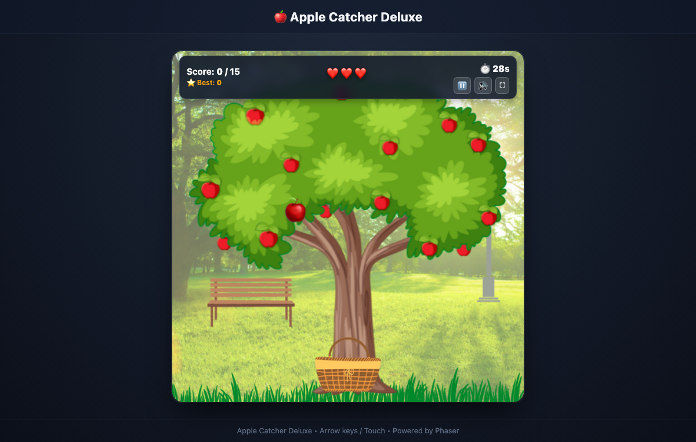
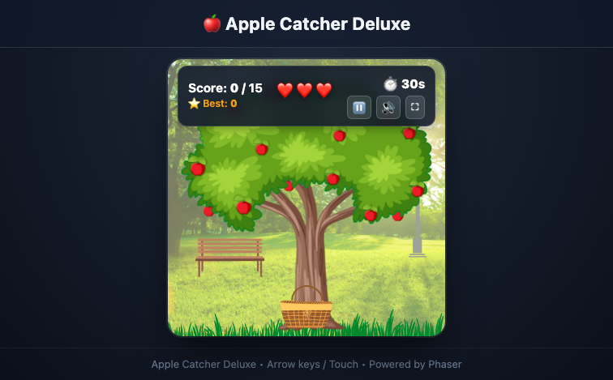

# Multimedia Systems Lab — Lab Test 2
## Problem Statement: Develop a Customizable 2D Arcade Game

**Course:** Multimedia Systems Lab  
**Evaluation:** Lab Test 2  
**Student Name:** Geetanshi Jain  
**Roll No:** IC-2K22-34  
**Project Title:** Apple Catcher Deluxe — Interactive 2D Arcade Game  
**Technology Stack:** HTML5, CSS3, JavaScript (ES6 Modules), Phaser 3 (v3.80.1), Web Audio API, Vite  

---

## 1. Project Overview & Objective

The objective of this project is to design, develop, and demonstrate a fully responsive, interactive 2D casual arcade game that exhibits fundamental multimedia systems principles:
1. **Interactive Multimedia Integration:** High-DPI vector sprites, bitmap graphics, particle emitters, camera post-processing fx, and custom real-time audio synthesis.
2. **Animation & Physics:** 60 FPS continuous animation loop, discrete multi-item velocity simulation, rotational physics, and dynamic tween transitions.
3. **User Interaction & Event Handling:** Cross-device input handling supporting Keyboard (Arrow keys & A/D), Mouse horizontal pointer tracking, and Mobile Touch gestures.
4. **Collision Detection & Scoring Logic:** Overlap collision detection with tuned bounding box hitboxes, streak combos, debuffs, and state-driven game progression.
5. **State Management & Persistence:** Distinct game lifecycle states (`MENU`, `PLAYING`, `PAUSED`, `GAME_OVER`), persistent high scores, and instant in-memory replay without page reloading.

---

## 2. Individual Customization Details

In accordance with the **Individual Customization Requirement** for Lab Test 2, this game implements an individually customized theme, multi-item hazard system, debuff mechanic, and combo progression:

| Custom Element | Category | Specification & Behavior | Multimedia / Visual Feedback |
|---|---|---|---|
| 🍎 **Normal Apple** | Collectible | Primary scoring item (+1 point). Increments the consecutive combo streak. Missing it at the bottom costs **1 Life**. | Collection chime (Web Audio pop), floating green `+1`, gold coin particle burst. |
| 🌟 **Golden Apple** | Rare Bonus | High-value bonus (+5 points). Spawns at a 5% weighted rate and falls 25% faster. Counts toward combo. | Ascending C-Major arpeggio chime, floating golden `+5`, star sparkle particles. |
| ⏰ **Clock Power-Up** | Time Extender | Adds **+5 seconds** to remaining countdown timer. | Rising triad chime, cyan floating `+5 SEC`. |
| 🤢 **Rotten Apple** | Custom Hazard | Deducts **-2 points** (score never drops below 0). Resets the active combo streak to 0. | Descending squish/buzz, red floating `-2`, red camera screen flash, basket wobble. |
| 🐛 **Bug / Insect** | Debuff Obstacle | Applies a **3-second movement speed reduction** (~45% slowdown) to the basket. Resets combo streak. | Modulated 30Hz fluttering buzz, yellow floating `SLOWED!`, dynamic HUD slow badge. |
| 💣 **Bomb** | Lethal Hazard | Causes immediate loss of **1 Life**. Resets combo streak. | Low-pass filtered noise explosion, red floating `-1 LIFE`, camera shake and red flash. |
| ⚡ **2X Frenzy Mode** | Custom Rule | Catching **5 consecutive qualifying apples** activates **2X FRENZY** for 5 seconds (doubles all positive points: +1 ➔ +2, +5 ➔ +10; negative penalties remain unaffected). | Energetic fanfare chime, pulsating HUD Frenzy banner, floating text multiplier. |
| ❤️ **3-Heart Life System** | Life Rule | Player begins with 3 hearts (`❤️❤️❤️`). Decremented when a normal apple is missed or a bomb is caught. | Heart icon greys out (`🖤`), camera damage flash, alarm beep. 0 lives triggers Game Over. |
| ⛶ **Full Window / Fullscreen** | Display | One-click button (`⛶`) and `F` key to expand the game canvas into true full-screen mode. | Dynamic aspect-ratio responsive scaling without distortion. |

---

## 3. Functional Requirements Compliance Checklist

- [x] **Game Interface:** Styled title menu, interactive item legend, live top HUD (Score, High Score, Hearts, Timer, Combo, Badges), pause modal, and game-over summary.
- [x] **Player Controls:** Arrow keys (Left/Right), A/D keys, Mouse pointer tracking, and Touch drag on mobile/touch screens.
- [x] **Animation Loop:** Phaser 60 FPS update cycle, angular velocity wobbles on falling hazards, particle explosions on catch, and floating text tweens.
- [x] **Collision Detection:** Arcade Physics overlap with tuned basket rim hitboxes, immediate object recycling to avoid double-collision triggers.
- [x] **Scoring & Penalties:** Positive points (+1, +5), negative points (-2 with lower clamp at 0), non-multiplied penalties during Frenzy.
- [x] **Difficulty Progression:** Dynamic scaling from 1 up to 3 simultaneous falling items, progressive fall speeds (250 px/s up to 520 px/s).
- [x] **Game States:** Strict finite state machine (`MENU`, `PLAYING`, `PAUSED`, `GAME_OVER`).
- [x] **Multimedia Integration:**
  - *Graphics:* Custom high-contrast SVG vector items (`rotten_apple.svg`, `golden_apple.svg`, `bug.svg`, `clock.svg`, `bomb.svg`, `heart_full.svg`, `heart_empty.svg`).
  - *Audio:* Web Audio API synthesizer generating real-time oscillators, noise buffers, and ADSR gain envelopes for zero-latency playback.
  - *Visual Effects:* Camera flash post-processing, basket bounce/shake tweens, particle emitter bursts.
- [x] **Individual Customization:** Functional debuff (Bug speed drag), hazard penalties (Rotten Apple score penalty, Bomb life loss), and 2X Frenzy combo mechanic.
- [x] **In-App Restart:** Instant "Play Again" button resetting game state and physics entities without reloading the browser window.

---

## 4. Algorithm & Collision Detection Logic

### 4.1 Game Architecture & State Machine

```
      +------------------+
      |      MENU        | <---------------+
      +------------------+                 |
               | (Start Game / Space)      |
               v                           |
      +------------------+                 | (Main Menu)
      |     PLAYING      | <---+           |
      +------------------+     |           |
        |        |   ^         |           |
 (P/Esc)| (Miss) |   | (Resume)| (Restart) |
        v        v   |         |           |
   +-------+   +-------+       |           |
   |PAUSED |   | Lives |       |           |
   +-------+   | <= 0  |       |           |
               +-------+       |           |
                   |           |           |
                   v           |           |
      +------------------+     |           |
      |    GAME OVER     | ----+-----------+
      +------------------+
```

### 4.2 Collision Detection Algorithm (Axis-Aligned Bounding Box — AABB)

Collision detection uses Phaser's Arcade Physics separation algorithm:
1. **Hitbox Tuning:** The basket's physics body is constrained to its upper opening rather than the entire sprite:
   $$\text{Hitbox Width} = \text{Sprite Width} \times 0.75$$
   $$\text{Hitbox Height} = \text{Sprite Height} \times 0.35$$
   $$\text{Offset} = (0.125 \times \text{Width}, 0.5 \times \text{Height})$$
2. **Overlap Condition:** An overlap occurs when the projection of the item and basket overlap on both axes:
   $$\left( |X_{\text{item}} - X_{\text{basket}}| < \frac{W_{\text{item}} + W_{\text{basket}}}{2} \right) \land \left( |Y_{\text{item}} - Y_{\text{basket}}| < \frac{H_{\text{item}} + H_{\text{basket}}}{2} \right)$$
3. **Atomic Collision Handling:** Upon intersection, the item sprite is immediately deactivated (`destroy()`) and passed to `GameState.catchItem(itemDef)` to prevent duplicate collision processing across subsequent physics sub-steps.

### 4.3 Normalized Weighted Probability Spawning Algorithm

Items are selected at runtime using cumulative distribution sampling:
$$\text{Total Weight} = \sum_{i=1}^{n} w_i$$
A random floating-point value $r \in [0, \text{Total Weight})$ is generated. The item whose cumulative sum interval satisfies $\sum_{j=1}^{k-1} w_j \le r < \sum_{j=1}^{k} w_j$ is spawned at a randomized horizontal coordinate $X \in [35, \text{Width} - 35]$.

---

## 5. Controls & Game Rules

### Controls Summary
| Action | Keyboard | Mouse / Touch |
|---|---|---|
| **Move Basket Left** | `Left Arrow` or `A` | Drag mouse / finger left |
| **Move Basket Right** | `Right Arrow` or `D` | Drag mouse / finger right |
| **Pause / Resume** | `P` or `Escape` | Click HUD Pause button (`⏸️`) |
| **Start / Replay** | `Space` or `Enter` | Click Start / Play Again button |
| **Toggle Sound** | Mute button | Click HUD Sound button (`🔊` / `🔇`) |
| **Toggle Fullscreen** | `F` key | Click HUD Fullscreen button (`⛶`) |

### Scoring & Rules
- **Normal Apple:** $+1$ point (increased to $+2$ during Frenzy). Increments combo. Miss = $-1$ Life.
- **Golden Apple:** $+5$ points (increased to $+10$ during Frenzy). Increments combo. No miss penalty.
- **Rotten Apple:** $-2$ points. Resets combo streak to 0. (Score clamped at $\ge 0$).
- **Bug:** Reduces basket speed by $45\%$ for $3$ seconds. Resets combo.
- **Clock:** Adds $+5$ seconds to the remaining timer.
- **Bomb:** Deducts $1$ life. Resets combo streak to 0.
- **Game Over:** Triggered when lives reach $0$ or timer reaches $0$.

---

## 6. Execution Instructions

### Prerequisites
- [Node.js](https://nodejs.org/) (Version 18.x, 20.x, or 23.x recommended)
- npm (Version 9.x or higher)

### Setup & Run Commands

```bash
# 1. Clone or navigate to the project directory
cd Apple-Catcher

# 2. Install dependencies
npm install

# 3. Start local development server
npm run dev
```

Open your browser at **`http://localhost:3000`** (or the port output in the terminal).

### Production Build & Preview
```bash
# Create optimized production bundle
npm run build

# Preview production bundle locally
npm run preview
```

### Running Automated Test Suite
```bash
# Executes 22 unit & integration tests (scoring, lives, combos, timers, boundaries)
npm test
```

---

## 7. Screenshots

### Active Gameplay Screen


### Game Over / Summary Screen


---

## 8. Technical Constraints & Code Authenticity

- **Self-Contained Architecture:** All game logic, state management, and audio synthesis are implemented with standard vanilla JavaScript and Phaser 3 arcade primitives.
- **No External Generative APIs:** Zero external AI services or network dependencies required at runtime; all assets and audio are stored or synthesized locally.
- **Evaluation Readiness:** All code is cleanly modularized into `src/game/constants.js`, `src/game/gameState.js`, `src/game/audio.js`, and `main.js` with comprehensive comments for viva/demonstration explanations.

---

**Submitted by:** Geetanshi Jain (Roll No: IC-2K22-34)  
**Multimedia Systems Lab Test 2**
